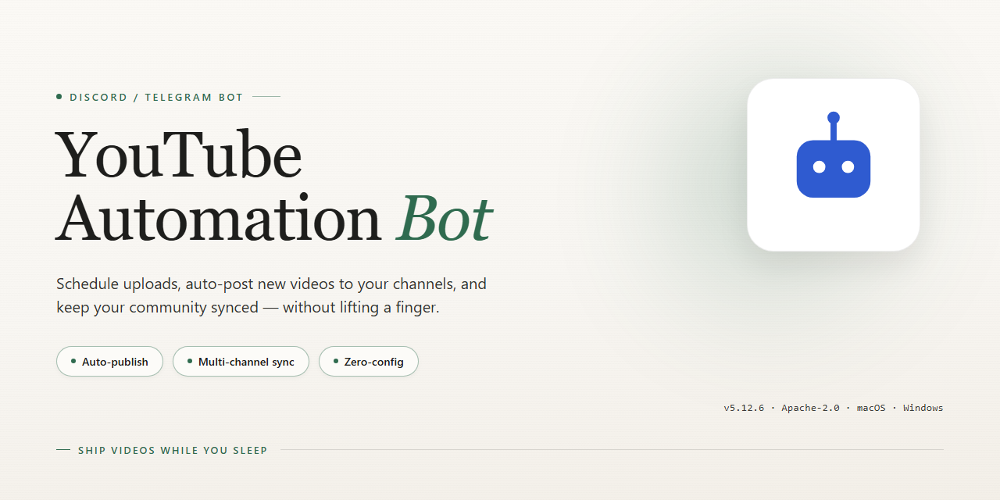

# 🤖 Community-Driven YouTube Automation Bot for Discord & Telegram

### 🖥️ PowerShell Setup

   

---

YouTube Automation Bot is a community-driven project built for creators and tinkerers who want to take the busywork out of running a channel. It packs a rich set of automation features into one friendly toolkit, whether you're scheduling uploads, managing content, or keeping your workflow moving without constant manual effort. Fair warning: the code has aged a bit, so expect to roll up your sleeves and make a few changes before everything runs smoothly. That's part of the fun, and the community around the project is here to help you get there.

## ✅ Requirements

- **PowerShell 5.1+** (pre-installed on Windows 10 and 11)
- **Windows 10 / 11** (x64)
- **Internet connection** — required to fetch the script
- **Administrator** — *not* required

## Features

**🔍 Smart search & discovery:** Quickly find channels, videos, and trending content without leaving the chat — the bot does the digging so you don't have to.
- **📥 One-command downloads:** Pull audio and video on demand, with clean formatting and sensible defaults that just work.
- **📤 Automated uploads:** Schedule and push your own content to your channel from the bot — set it up once and let it run.
- **🎬 Shorts support:** Generate and publish short-form clips with a streamlined workflow built for vertical video.
- **📊 Channel insights:** Check subscriber counts, view stats, and video performance at a glance so you always know where you stand.
- **🔔 Notifications & alerts:** Get pinged when new uploads drop from channels you follow, or when your scheduled posts go live.
- **🌐 Cross-platform friendly:** Works in both Discord and Telegram, so your community can use it wherever they already hang out.
- **⚙️ Configurable behavior:** Tweak prefixes, defaults, and feature toggles to match your server or group's vibe.
- **🧩 Modular design:** Each feature lives in its own piece, making it easy to enable what you need and skip what you don't.
- **🛠️ Community-maintained:** Built and improved by contributors — if something's outdated, a small tweak is usually all it takes to get it running again. PRs and ideas are always welcome!
- **💬 Friendly by design:** Clear responses, helpful error messages, and no cryptic jargon — newcomers and power users alike feel at home.
- **🚀 Lightweight & self-hosted:** Run it on your own machine or server, keep your data yours, and scale at your own pace.

## Commands

Here's a friendly, feature-rich breakdown of everything the bot can do. Commands work across both Discord and Telegram unless noted otherwise, and most accept aliases so you can type what feels natural. Prefixes vary by platform and configuration, so check your setup if a command doesn't respond.

- **/start** — Wake the bot up and get a quick welcome with the essentials. Great first stop when you're new.
- **/help** — Show the full command list grouped by category, plus links to relevant config options. Add a command name for detailed usage and examples.
- **/status** — Check whether the bot is healthy, which platform it's serving, and the last time it synced with your channel.
- **/login** — Connect your account so the bot can act on your behalf. Follow the prompts; credentials are stored locally.
- **/logout** — Disconnect your account and clear the stored session.
- **/upload** — Push a video to your channel. Accepts a file, a link, or a reply to an existing message. Supports titles and descriptions.
- **/schedule** — Queue an upload for a specific date and time. Handy for keeping a consistent posting rhythm.
- **/unschedule** — Cancel a pending scheduled upload by its ID.
- **/queue** — List everything waiting to publish, with timestamps and status.
- **/shorts** — Create or manage short-form content. Automatically trims and reformats according to your settings.
- **/search** — Find videos by keyword, channel, or tag. Returns results you can act on directly.
- **/download** — Save a video or audio track locally for editing or reposting. Choose format and quality.
- **/stats** — Pull channel metrics: views, subscribers, and recent performance. Great for quick check-ins.
- **/subs** — Review subscriber counts and trends over a chosen period.
- **/comments** — Fetch and moderate recent comments. Reply, hide, or flag them from chat.
- **/tags** — Suggest and apply tags to improve discoverability. Works with your existing metadata.
- **/thumbnail** — Set or replace a video thumbnail. Upload an image or pick from saved presets.
- **/metadata** — View and edit title, description, and tags for a specific video in one place.
- **/notify** — Toggle notifications for uploads, comments, or errors. Choose per-platform delivery.
- **/settings** — Open the interactive settings panel. Change defaults, prefixes, and behavior without editing files.
- **/language** — Switch the bot's response language. Community translations welcome.
- **/ping** — Quick latency check. Mostly for fun, occasionally useful.
- **/feedback** — Send a note to the maintainers. Bug reports, ideas, and praise all welcome.

Commands accept common aliases (for example, `up` for upload and `sched` for schedule), and every command supports a `help` argument for inline guidance. Permissions are role-based, so admins can restrict sensitive actions like uploads and settings. If a command isn't available in your server, ask an admin to grant the right role.

Found a bug or want a new command? Open an issue or drop a message in the community channels — feature requests are how this project keeps growing. Please note the code may be old, so a few commands might need small tweaks to work on your setup; patience and pull requests are appreciated.

## Configuration

Getting the bot tuned to your server or channel is where the fun really begins — and we've kept it as friendly as possible. Everything lives in a single, readable config file, so you can tweak, experiment, and re-run without ever touching the core logic. Whether you're a first-time tinkerer or a seasoned self-hoster, the setup is designed to feel like a conversation, not a chore.

### What You Can Configure

- **Platform connection** — plug in your bot credentials for Discord, Telegram, or both. Run one, run the other, or run them side by side.
- **Channel & chat targets** — tell the bot exactly where uploads, notifications, and status updates should land.
- **Upload defaults** — set your preferred title patterns, description templates, tags, visibility, and category so every new video starts off on the right foot.
- **Scheduling & automation** — choose how often the bot checks for new content, whether it publishes immediately or queues for later, and how it handles retries.
- **Search & discovery options** — fine-tune result limits, filters, and how much detail gets returned in responses.
- **Language & messaging** — customize the wording of replies and pick the language that fits your community.
- **Logging & verbosity** — dial the chatter up or down depending on whether you're debugging or just running quietly in the background.

### A Note on the Code

Because this project has been around for a while, some parts of the codebase may need small adjustments to work with current platform APIs and library versions. Don't worry — that's part of the charm. Expect to:

- Review the config values and match them to your current environment.
- Update a few dependencies or endpoints if something has shifted over time.
- Test commands in a private space first, then roll out to your wider community once you're happy.

The community has been wonderfully helpful in flagging quirks and sharing fixes, so if something feels off, chances are someone else has already modified it — and we'd love for you to add your own discoveries too.

### Configuration Tips From the Community

- Keep a backup of your working config before making big changes — future you will be grateful.
- Start with the defaults, get one feature working end-to-end, then expand.
- Use the logging options while setting things up so you can see exactly what the bot is doing.
- Share your setups and favorite tweaks — community-driven configs are how this bot keeps getting better.

Every configuration is a little different, and that's exactly the point. Make it yours, break it gently, fix it proudly, and enjoy the automation. 💙

## FAQ

**Q: Is the code up to date?**
Not necessarily — this project has been around for a while, so some parts may be outdated. Expect to make a few tweaks to get everything running smoothly on your setup. The community is always sharing fixes and workarounds, so you're in good company.

**Q: The bot isn't working out of the box. What should I do?**
Don't panic! Because the code might be old, a little adjustment is usually all it takes. Check the configuration section, review your settings, and compare against recent community discussions — chances are someone has already hit the same snag and posted a solution.

**Q: Can I use this on both Discord and Telegram?**
Yes! The bot is designed to work across both platforms, letting you automate and manage your YouTube workflows from whichever chat app your community lives in. Configure each platform to your liking and let the bot handle the rest.

**Q: What features does the bot actually offer?**
Plenty — automated uploads, search helpers, Shorts support, subscriber-focused utilities, and more. It's built to be feature-rich and flexible, so you can tailor it to your channel's needs. Explore the commands and configuration to unlock everything.

**Q: How do I request a new feature or report a bug?**
The project thrives on community input. Open an issue, start a discussion, or jump into the conversation with other users. Friendly feedback and clear bug reports help everyone — and contributions of all sizes are genuinely welcome.

**Q: Can I contribute to the project?**
Absolutely! Whether it's fixing outdated code, improving docs, adding features, or just sharing ideas, contributions are what keep this bot alive and growing. Fork it, experiment, and send your improvements back to the community.

**Q: Is there support if I get stuck?**
Of course. The community and maintainers are here to help — ask questions, share what you've tried, and someone will usually point you in the right direction. Friendly, community-driven support is at the heart of this project.

**Q: Will this work with my current setup?**
Since the code may need adjustments, compatibility can vary depending on your environment. Take a moment to review the configuration options, test in a safe environment first, and lean on the community for tips specific to your setup.

**Q: Is the bot free to use?**
Yes — it's an open, community-driven project. Use it, learn from it, improve it, and share it. Just remember to respect the license and give credit where it's due.

## Support

Whether you’re scripting your first automated upload or maintaining a full content pipeline, you’re part of the YouTube Automation Bot community now — and we’ve got your back. Here’s how to get help, share ideas, and help shape what comes next.

**Where to start**
- Skim the Features, Commands, Configuration, and FAQ sections first — most setup questions are answered right there.
- Since this codebase may be older, expect to make a few tweaks to get things working on your setup. Small adjustments are normal and part of the fun.

**Ask questions and share findings**
- Open a discussion or issue in the project itself. Include your environment, the exact command you ran, what you expected, and what actually happened — clear reports get faster answers.
- Logs and error messages are welcome (trim any private keys, tokens, or personal details first).
- Reproducible examples help everyone: a minimal config and the command that triggers the problem go a long way.

**Contribute back**
- Found a fix for outdated code? Send a pull request with a short explanation of the change and why it’s needed.
- Documentation improvements, command examples, and configuration recipes are just as valuable as code.
- If you’ve built something on top of the bot, share it — community extensions and workflows make the whole project stronger.

**Shape the roadmap**
- Vote on feature requests and open issues. Popular ideas get prioritized.
- Suggest new commands, automation flows, or configuration options — the bot grows in the direction the community pushes it.
- Try pre-release changes when they’re available and report what you find.

**Community guidelines**
- Be kind and patient — everyone here is learning, and maintainers are volunteers.
- Search before posting; if your question was already answered, add your experience to the existing thread instead of starting a new one.
- Keep discussions focused on the YouTube Automation Bot; off-topic chatter belongs elsewhere.
- No spam, no self-promotion, and no sharing of credentials or private data.

**Staying in the loop**
- Watch the project repository to get notified about new releases, fixes, and breaking changes.
- Check the changelog before updating so you know what to adjust in your setup.

Every bug report, pull request, and helpful reply makes the YouTube Automation Bot better for the next person. Thanks for being part of it — now go build something great.

## License

This project is shared in the spirit of the open-source community — free to use, learn from, and build upon. Whether you're automating your own channel, exploring how the bot works under the hood, or adapting pieces of it for your own setup, you're welcome here.

A few friendly ground rules:

- **Use it, remix it, improve it.** Fork it, tinker with it, add your own features, and share your changes back so everyone benefits. Pull requests and ideas are always appreciated.
- **Credit is appreciated.** If you build something cool on top of this, a nod back to the project is a nice touch (and helps others find it).
- **No warranty.** The code is provided as-is, and remember — it might be a little old, so expect to make a few tweaks to get things running smoothly. Use it responsibly and at your own risk.
- **Be kind.** This is a community-driven project built by people who enjoy sharing. Respect the work, respect each other, and help keep the space welcoming.

Have fun automating, and thanks for being part of the journey!